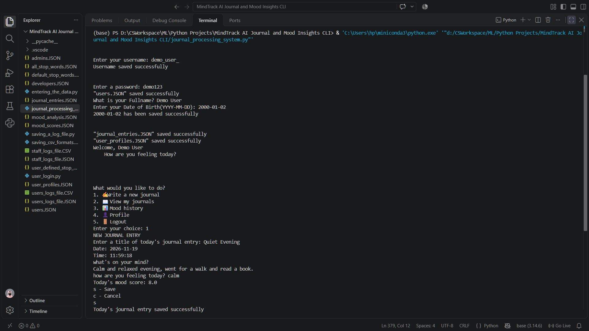
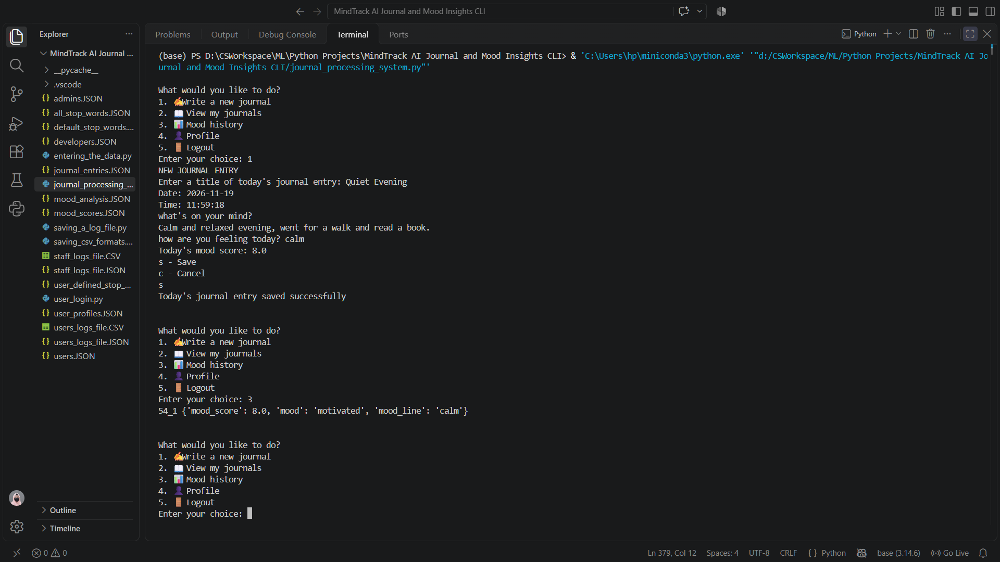
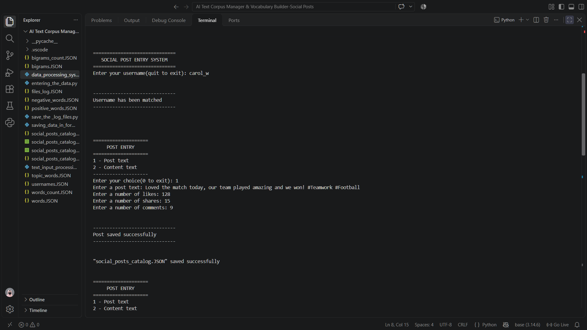
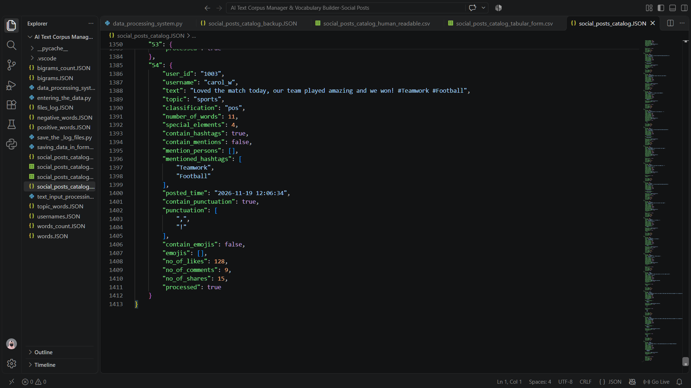
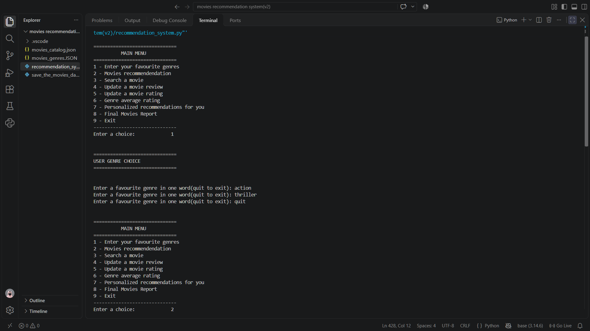
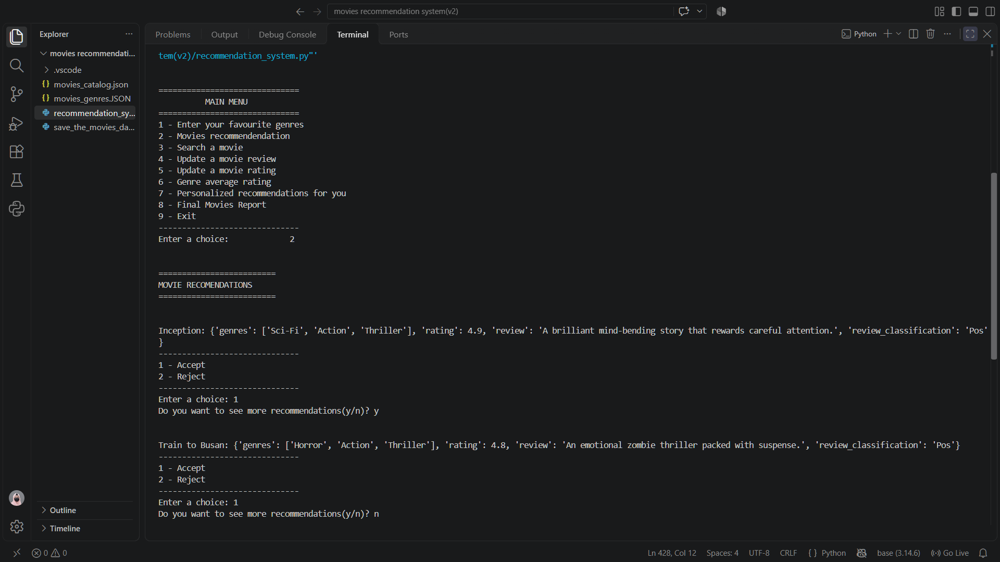
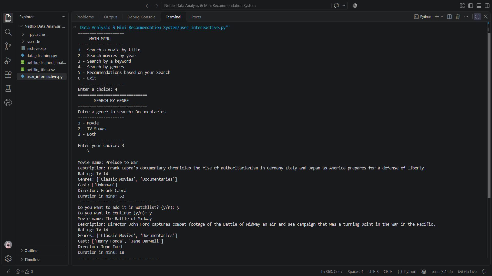

# Python Mini Projects

A portfolio of Python applications built from the ground up, spanning CLI tools, rule-based AI, data analysis, recommendation systems, and full applications with login and data persistence. Each project focuses on solving a concrete problem with clean logic and thoughtful design.

## Featured Projects

### 🧠 MindTrack: AI Journal & Mood Insights CLI
A multi-user journaling application with account creation, login, and personalized mood tracking. Journal entries are automatically scored for mood using a custom text-analysis engine, with full history, search, sorting, and a personal profile dashboard.

**Highlights:** Object-oriented design, custom exception handling, user accounts, JSON-backed data persistence, CRUD functionality.

> **Note:** The login is a demo. Passwords are stored as plain text and are not meant for real use. The accounts in the data files are sample accounts.

<p>


</p>

[View Project →](./mindtrack-journal-cli)

### 📊 AI Text Corpus Manager & Vocabulary Builder
A social-media text analysis pipeline that processes posts in real time. It detects hashtags, mentions, and emojis, classifies sentiment, and identifies topics through keyword and bigram analysis. It builds a full word-frequency corpus and exports structured data to multiple formats.

**Highlights:** Tokenization, rule-based NLP, sentiment classification, bigram analysis, multi-format data export (JSON/CSV).

<p>


</p>

[View Project →](./ai-text-corpus-manager)

### 🎬 Movies Recommendation System (v2)
A recommendation engine built on a curated catalog of nearly 60 films, with genre tagging, ratings, and auto-classified reviews. It offers genre-based recommendations, search, live rating and review updates, and usage analytics through a menu-driven interface.

**Highlights:** Data modeling, ranking algorithms, sentiment classification, interactive CLI design.

<p>


</p>

[View Project →](./movie-recommender-v2)

### 📺 Netflix Data Analysis & Mini Recommendation System
Cleans and analyzes the public Netflix Movies and TV Shows dataset (8,807 titles), then lets you explore it from the command line. Search by title, year, keyword or genre, build a watchlist, and get recommendations based on your searches.

**Highlights:** Pandas data cleaning (missing values, splitting list columns, new features such as year added and runtime category), search and filtering, genre-overlap ranking.



[View Project →](./netflix_data_analysis_and_min_recommendation_system)

## Additional Projects

| Project | Description | Key Concepts |
|---|---|---|
| [Movie Recommender (v1)](./movie-recommender-v1/main.py) | A genre-based movie recommender with login/signup and an interactive accept/reject recommendation flow. The earlier version of v2. | Data structures, filtering & ranking logic |
| [Learning Chatbot (Rule-Based AI)](./learning-chatbot/main.py) | A chatbot that starts with a small knowledge base and grows it dynamically as users teach it new topics during conversation. | Conditional logic, adaptive session state |
| [AI Prompt Cost & Token Estimator](./ai-prompt-cost-estimator/main.py) | A budgeting tool that estimates token usage and API cost per prompt, with full usage history and receipts. | CLI design, cost modeling |

## Skills Demonstrated

- **Object-Oriented Programming:** classes, encapsulation, custom exceptions
- **Data Persistence:** JSON and CSV as lightweight data stores, structured read/write pipelines
- **Data Analysis with Pandas:** cleaning, feature creation, filtering a real dataset
- **Text Processing & NLP Fundamentals:** tokenization, sentiment classification, keyword and bigram-based topic detection
- **Application Design:** multi-file architecture, login flows, menu-driven CLI systems
- **Problem Solving:** turning real-world use cases (journaling, recommendations, social analytics) into working software

## Getting Started

Each project runs with Python 3. Install the libraries once from the main folder:

```bash
pip install -r requirements.txt
```

Then run a project from inside its folder:

```bash
cd mindtrack-journal-cli
python3 journal_processing_system.py
```

```bash
cd ai-text-corpus-manager
python3 text_input_processing_system.py
```

```bash
cd movie-recommender-v2
python3 save_the_movies_data.py
python3 recommendation_system.py
```

```bash
cd netflix_data_analysis_and_min_recommendation_system
python3 main.py
```

The cleaned Netflix file is included. `data_cleaning.py` recreates it from the original dataset.

Single-file projects (Movie Recommender v1, Learning Chatbot, Prompt Cost Estimator) run the same way with `python3 main.py` inside their folders.

**About the large `entering_the_data.py` files:** in MindTrack and the Corpus Manager, this file loads sample data (sample users, sample posts) so the projects have something to work with the first time you run them.

## About

This repository reflects my ongoing practice in Python development, moving from focused CLI tools toward more complete applications involving login, data persistence, data analysis, and lightweight natural language processing. Each project was built independently, with an emphasis on clean structure and practical functionality.

## License

This repository is licensed under the [MIT License](./LICENSE).
